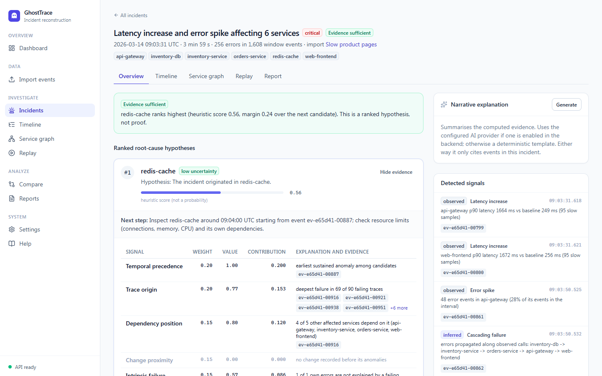
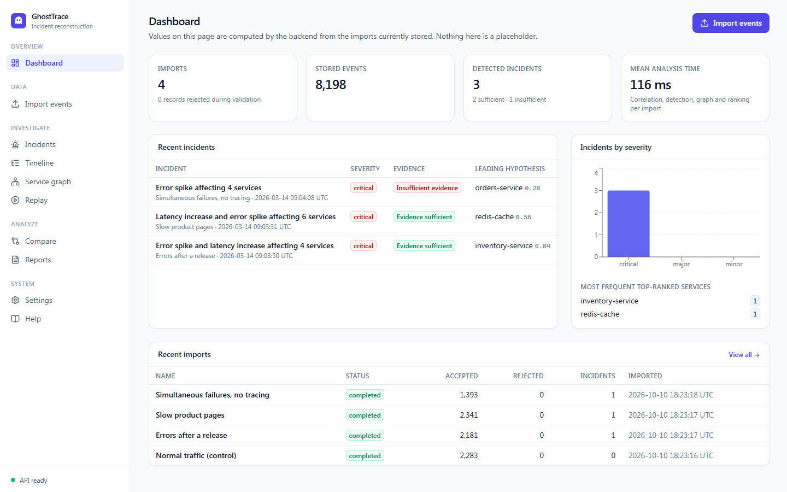
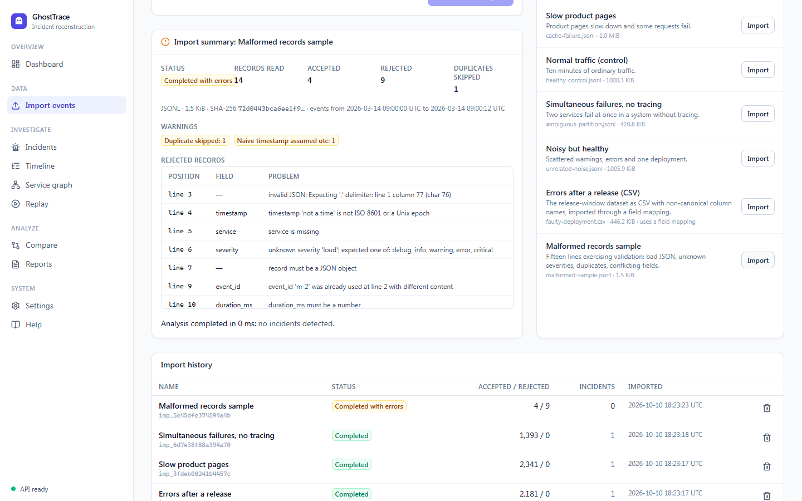
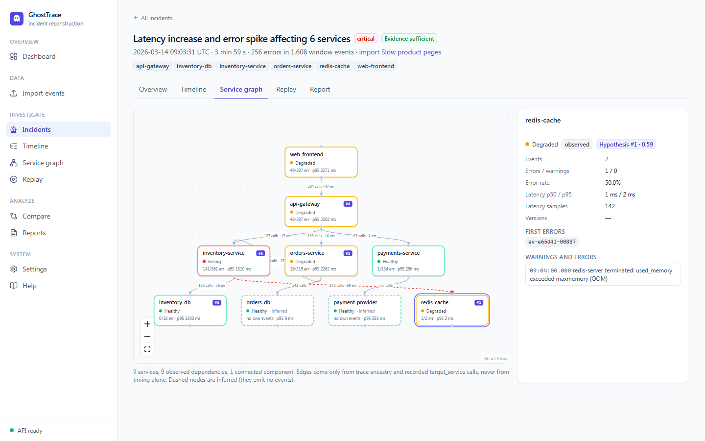
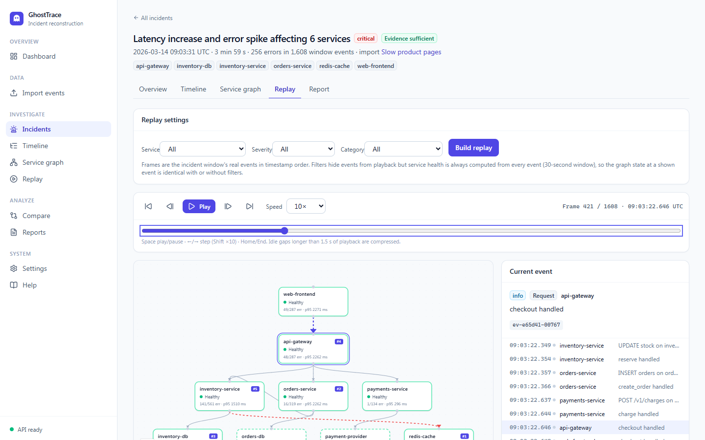
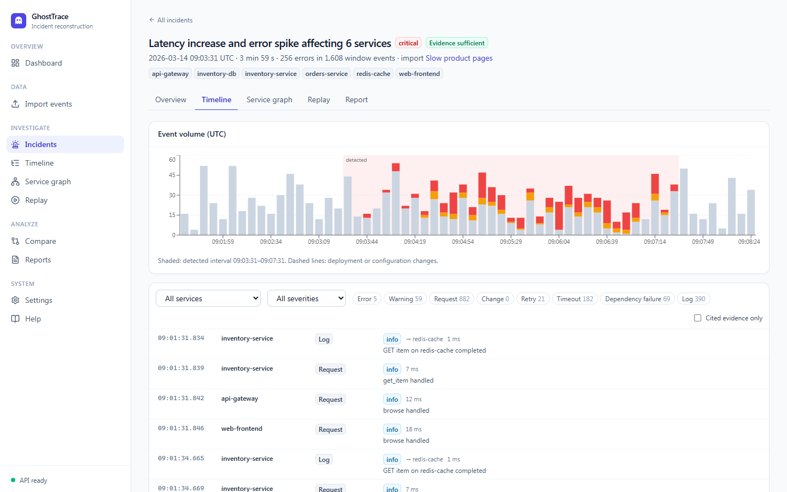
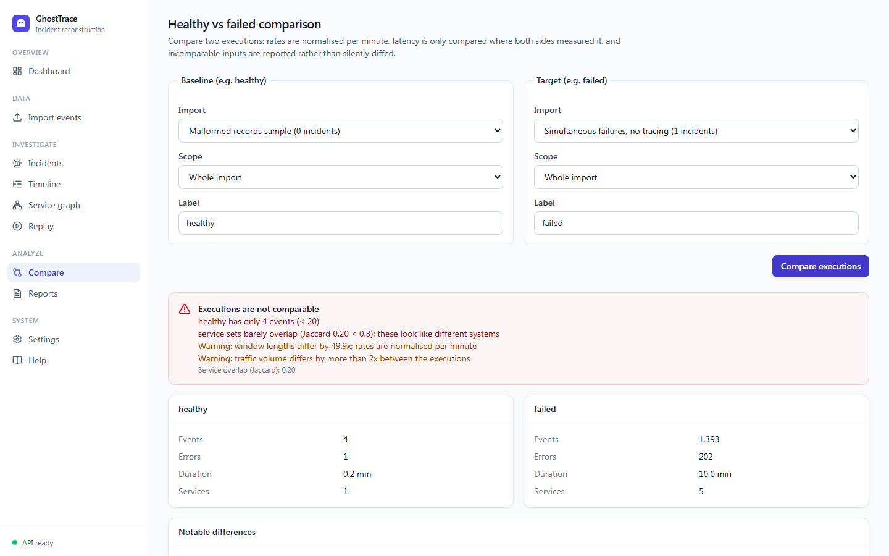
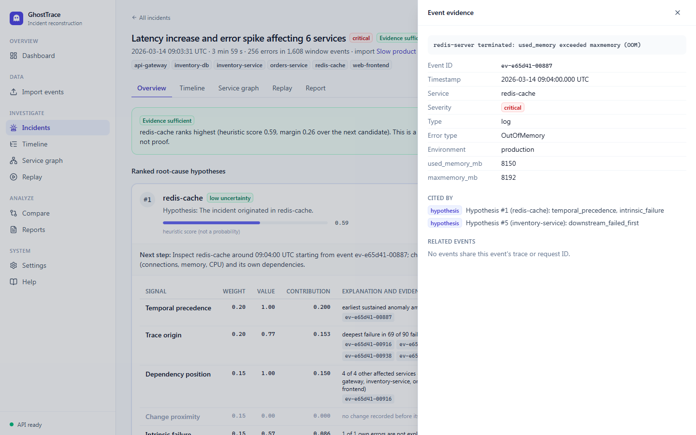
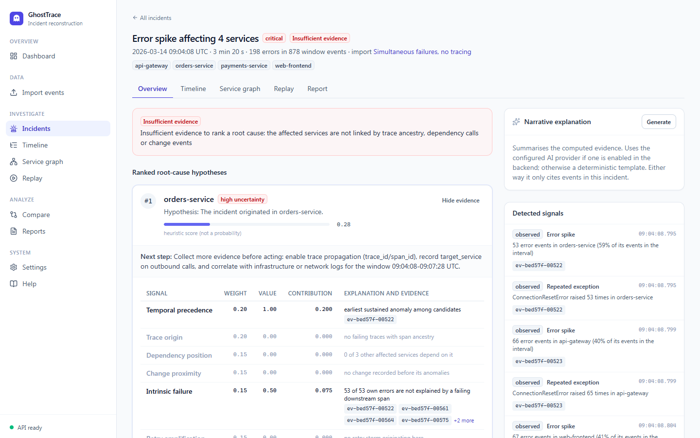
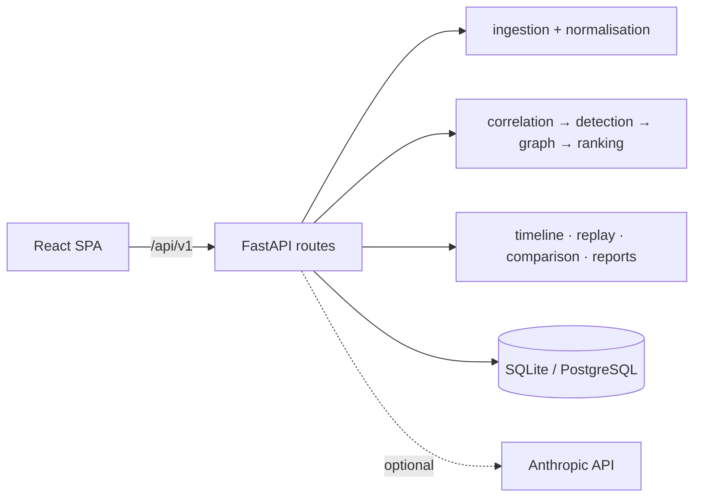

# GhostTrace

> Every failure leaves a trail. Reconstruct it.

GhostTrace is an explainable software incident reconstruction platform. It correlates application events, visualises service dependencies, replays failures and ranks evidence-backed root-cause hypotheses.



## The problem, and what GhostTrace does about it

During an incident, logs from many services arrive at once. The service that shouts loudest is usually a victim, not the cause. GhostTrace imports those events and:

1. **Validates and normalises** JSONL, JSON or CSV into one canonical event schema. Malformed records are rejected with their line numbers; they are never turned into plausible-looking events.
2. **Correlates** events through trace ancestry, request IDs and recorded dependency calls. Timing alone never creates a causal link.
3. **Detects incidents** with statistical burst tests (error spikes, timeouts, retry storms, latency increases, failing dependencies, deployment regressions). Each signal is labelled *observed* or *inferred*.
4. **Ranks root-cause hypotheses** with a transparent, deterministic score built from six signals minus penalties for contradictory evidence. Every value cites real event IDs. When the evidence is not there, it reports **insufficient evidence** instead of guessing.
5. Lets you **inspect, replay, compare and export**: an interactive timeline and service graph, a frame-by-frame replay with synchronised service health, a healthy-versus-failed comparison, and JSON or Markdown reports whose cited event IDs are all verified.

Scores are uncalibrated heuristics, **not probabilities**. A top-ranked hypothesis is supported by correlation, not proven.

## Features

| Area | What it does |
| --- | --- |
| Ingestion | JSON Lines, JSON array or `{"events": [...]}` envelope, CSV with field mapping. Field aliases, UTC normalisation, derived IDs, duplicate and conflicting-ID detection, upload and record limits, line-level errors, failed imports kept in history |
| Correlation | Span trees, cross-service edges, inferred external dependencies, error propagation, trace origins |
| Detection | Poisson burst tests against a robust baseline. Error spike, repeated exception, timeout cluster, retry storm, dependency failure, latency increase, deployment/config/version regression, cascading failure, missing trace context |
| Root cause | Temporal precedence, trace origin, dependency position, change proximity, intrinsic failure and retry amplification, minus penalties for contradictions. Uncertainty levels, missing information, next investigation step |
| Graph | Directed service graph from evidence only. Node health, Tarjan cycle detection, depth, components; click-through to evidence |
| Timeline | Histogram with the detected window and change markers; filters by service, severity, category, time and cited evidence |
| Replay | Deterministic frames; play, pause, step, jump, speed and keyboard control; health stays consistent under filters |
| Comparison | Per-minute rates, error rates, p95 latency (only where measured), versions, edges; explicit "not comparable" verdicts |
| Reports | JSON and Markdown: summary, timeline, impacted services, hypotheses, evidence, missing evidence, recommendations, comparison. Event IDs verified; untrusted text escaped |
| AI (optional) | Off by default. Uses Anthropic's official SDK with schema-validated output; cites only incident evidence; falls back to a deterministic template |

## Screenshots

All screenshots were captured from the running application by `npm run screenshots` (Playwright).

| | |
| --- | --- |
|  |  |
|  |  |
|  |  |
|  |  |

## Architecture



Business logic lives in pure, database-free services (`backend/app/services`) that the API, tests and benchmark all call. See [docs/architecture.md](docs/architecture.md) for the component and data-flow diagrams and [docs/analysis.md](docs/analysis.md) for every rule, threshold and weight.

## Technology

* **Backend:** Python 3.12, FastAPI 0.143, Pydantic 2.14, SQLAlchemy 2.1, Alembic 1.20, SQLite (default) or PostgreSQL via psycopg 3. The analysis needs no ML or GPU libraries; it uses only the standard library on top of Pydantic.
* **Frontend:** React 19, TypeScript 6 (strict), Vite 8, Tailwind CSS 4, TanStack Query 5, React Flow 12 (graph), Recharts 3 (charts), lucide-react (icons).
* **Quality:** pytest and coverage, Ruff, mypy (strict), Vitest 5 with React Testing Library, ESLint 10, Playwright 1.64, GitHub Actions, pip-audit and npm audit.
* **Deployment:** a single Docker image, Docker Compose with an optional PostgreSQL profile, and Render and Railway configs.

## Run it on Windows (PowerShell)

**Requirements:** Python 3.12, Node.js 22 and Git. About 400 MB of disk for dependencies (257 MB `node_modules`, 123 MB Python venv, plus a browser download only if you run Playwright without Microsoft Edge). The app itself uses well under 1 GB of RAM. Only Python 3.12 has been tested.

```powershell
git clone https://github.com/<your-github-username>/ghosttrace.git
cd ghosttrace

# Backend: terminal 1
cd backend
py -3.12 -m venv .venv          # or: uv venv --python 3.12 .venv
.\.venv\Scripts\python.exe -m pip install -r requirements-dev.txt
.\.venv\Scripts\python.exe -m uvicorn app.main:app --reload --port 8000
```

```powershell
# Frontend: terminal 2
cd frontend
npm ci
npm run dev                      # http://localhost:5173 (proxies /api to :8000)
```

Then open <http://localhost:5173>, go to **Import events**, and import a bundled dataset (for example "Slow product pages").

| URL | What |
| --- | --- |
| http://localhost:5173 | Frontend (development) |
| http://localhost:8000/api/v1 | API |
| http://localhost:8000/docs | Interactive OpenAPI documentation |
| http://localhost:8000/api/v1/ready | Readiness probe |

> **Note:** If Windows blocks `.venv\Scripts\*.exe` ("Application Control policy"), keep using `python.exe -m <tool>` as shown. There is no need to activate the venv. See [troubleshooting](docs/troubleshooting.md).

Copy [`.env.example`](.env.example) to `backend/.env` to change settings. Defaults: SQLite in `backend/data/`, 10 MiB uploads, 24 h retention, AI off.

### Docker

```powershell
docker compose up --build app          # http://localhost:8000: API and UI in one container
docker compose down                    # stop (add -v to delete the SQLite volume)

docker compose --profile postgres up --build postgres app-postgres   # PostgreSQL variant on :8001
```

## Demo walkthrough

1. **Import events** → import *Slow product pages* (a cache failure) and *Normal traffic (control)*.
2. Open the detected incident. Hypothesis #1 should be `redis-cache`; expand it to see each signal's value, explanation and evidence.
3. Click an event ID to open the evidence drawer: raw fields, related trace events, and which signals cite it.
4. Check the **Timeline**, **Service graph** and **Replay** tabs (press Space to play).
5. Under **Compare**, the defaults compare the healthy and failed imports.
6. On the incident's **Report** tab, generate and download a report.
7. Import *Simultaneous failures, no tracing* to see an "insufficient evidence" result.

A timed script is in [docs/demo-script.md](docs/demo-script.md).

## API

A versioned REST API lives under `/api/v1`: health and readiness, imports, events, demo datasets, incidents, hypotheses, timeline, graph, event evidence, replay, comparisons, reports, explanations, dashboard and settings. Errors share one JSON shape with a request ID. The full table and examples are in [docs/api.md](docs/api.md), the event schema in [docs/event-format.md](docs/event-format.md), and the live OpenAPI at `/docs`.

## Tests

```powershell
# Backend: from backend/
.\.venv\Scripts\python.exe -m ruff check --config pyproject.toml . ..\scripts ..\benchmarks
.\.venv\Scripts\python.exe -m ruff format --check --config pyproject.toml . ..\scripts ..\benchmarks
.\.venv\Scripts\python.exe -m mypy app
.\.venv\Scripts\python.exe -m pytest --cov=app
.\.venv\Scripts\python.exe ..\scripts\generate_datasets.py --verify

# Frontend: from frontend/
npm run lint; npm run typecheck; npm test; npm run build
npx playwright test e2e/incident-flow.spec.ts     # starts the backend and frontend; uses installed Edge
```

The end-to-end test generates a new synthetic incident, imports it through the UI, checks that the top hypothesis matches the ground truth, inspects evidence, filters the timeline, opens the graph, drives the replay controls and downloads a report.

## Benchmark

Run `backend\.venv\Scripts\python.exe benchmarks\run_benchmark.py`. The evaluation uses **held-out seeds** (2001-2010) of eight scenarios under three telemetry configurations: 240 runs and 577,081 events. Full methodology, failures and caveats are in [benchmarks/README.md](benchmarks/README.md).

| Configuration | Detection recall | Top-1 | Top-3 | Abstains when evidence is insufficient | False-positive rate |
| --- | ---: | ---: | ---: | ---: | ---: |
| standard (97% parent links) | 100% | 100% | 100% | 100% | 0% |
| degraded (80% parent links) | 100% | 100% | 100% | 100% | 0% |
| stress (60% parent links, 2% background errors) | 100% | 94% | 100% | 100% | 25% |

Ingestion classified every record correctly: 187,952 valid records accepted and 3,869 injected malformed records rejected. Analysis took 85 ms at the median per roughly 2,400-event run on a loaded 4-core laptop.

**Read these numbers with care.** The simulator and the heuristics were written by the same author, so the perfect scores show consistency on familiar failure modes, not real-world accuracy. The stress configuration shows where the approach breaks down.

## Security and privacy

GhostTrace has **no authentication**; treat it as a local or demo tool. It does implement streamed upload limits, safe parsing, rate limiting, restricted CORS, security headers and CSP, generic error responses, environment-based secrets, retention cleanup, a non-root container, and optional AI that never receives raw logs unless explicitly configured. Details and known gaps are in [docs/security.md](docs/security.md).

## Limitations

* The heuristics have been evaluated on synthetic data only.
* High background error rates cause false positives.
* Clock skew and trace sampling are not corrected.
* Concurrent unrelated problems can merge into one incident.
* Analysis is synchronous: a 10 MB upload takes a few seconds.
* There is no authentication or multi-tenancy, and the rate limiter is per process.

## Deployment

The single container suits Render's free web service, with the caveats that it sleeps when idle and its disk is ephemeral. Railway is supported too. See [docs/deployment.md](docs/deployment.md) for exact steps and a live-demo verification script.

## Contributing, roadmap and licence

* Contributing guide: [CONTRIBUTING.md](CONTRIBUTING.md).
* Architecture decisions: [docs/adr/](docs/adr).
* Troubleshooting: [docs/troubleshooting.md](docs/troubleshooting.md).

**Roadmap**

* OpenTelemetry (OTLP JSON) import.
* Clock-skew estimation from span timing.
* Splitting incidents by graph connectivity.
* Background analysis for large uploads.
* Authentication.
* A labelled corpus of real, anonymised incidents for calibrated evaluation.

Released under the [MIT License](LICENSE).

This project was developed with AI assistance (Anthropic's Claude).
