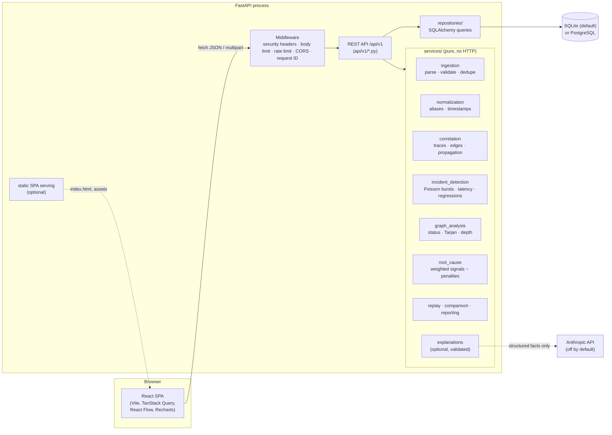
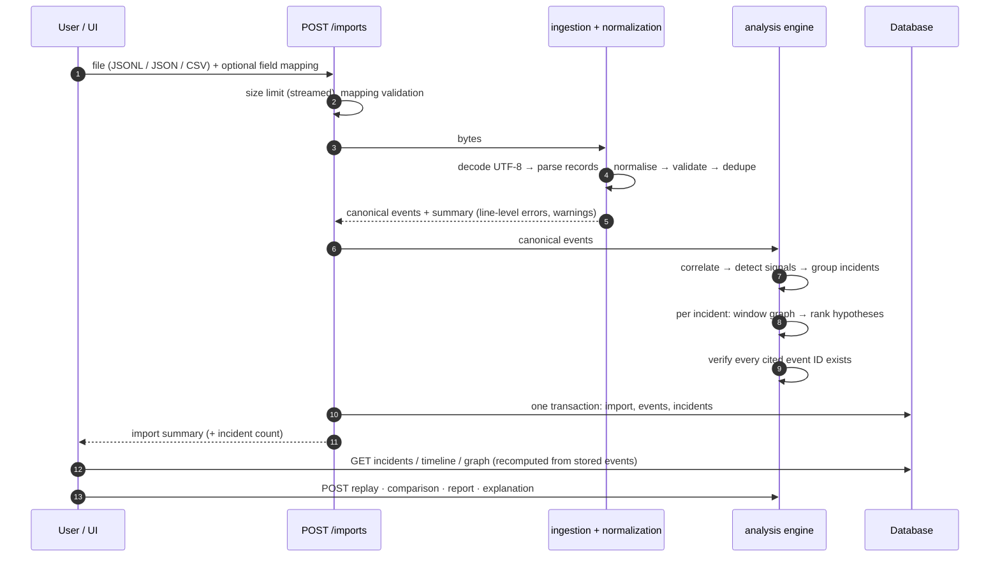

# Architecture

GhostTrace is a modular monorepo. It has a FastAPI backend, which contains the analysis engine, and a React single-page app. In production one container serves both on a single origin.

## Components



The layering rules are:

* **API handlers** in `backend/app/api/v1` validate input, call services, and map results to response schemas. They contain no analysis logic.
* **Services** in `backend/app/services` are pure Python over `CanonicalEvent` lists. The analysis engine (correlation, detection, graph, ranking, replay, comparison) never touches the database or HTTP, so tests and the benchmark call it directly.
* **Repositories** in `backend/app/repositories` hold all SQLAlchemy queries.
* **The simulator** in `backend/app/simulation` is used only by tests, the dataset script and the benchmark. The analysis engine never imports it, and ground truth is returned separately from the events.
* **The frontend** keeps data access (`src/services/api.ts`, `src/hooks/queries.ts`) apart from the feature components (`src/features/*`) and the shared UI primitives (`src/components`).

## Data flow



Analysis runs synchronously inside the import request. On the development laptop (4-core Intel, Windows 11, idle) a 9.8 MB file of 21,000 events, close to the 10 MiB upload limit, took 2.1 s to ingest and 0.65 s to analyse. 50,000 events took 5.0 s and 1.8 s. Database writes are not included in these figures. [ADR 0003](adr/0003-synchronous-analysis.md) explains why there is no job queue.

## Storage model

| Table | Holds |
| --- | --- |
| `imports` | Upload metadata, validation summary (counts, line errors, warnings), analysis status and timing, data-quality signals |
| `events` | Normalised canonical events, unique per `(import_id, event_id)`, indexed by time and trace |
| `incidents` | Detected window, signals, ranked hypotheses, evidence status and missing information, stored as JSON |
| `comparisons` | Stored comparison results, so reports can cite them |
| `reports` | Generated JSON or Markdown with SHA-256 and the count of verified event references |

Alembic migrations live in `backend/alembic/versions` (0001 to 0004). The app upgrades to head at startup, and `/api/v1/ready` reports `not_ready` if the schema is behind.

Timelines, graphs and replays are **recomputed** from stored events on each request rather than cached. This is deterministic and cheap at this scale, and it means a view can never disagree with the events it shows.

## Repository layout

```
backend/
  app/
    api/v1/          REST endpoints (health, imports, incidents, comparisons, reports, explanations, dashboard)
    core/            config, database, errors, migrations, security middleware, static serving
    models/          SQLAlchemy models
    repositories/    queries
    schemas/         Pydantic API schemas (canonical event schema in schemas/events.py)
    services/        ingestion, normalization, correlation, incident_detection, graph_analysis,
                     root_cause, replay, comparison, reporting, explanations, analysis.py
    simulation/      deterministic synthetic incident generator (tests/benchmarks only)
    tests/           pytest suite
  alembic/           migrations
frontend/
  src/components     layout, UI primitives, event evidence drawer
  src/features       dashboard, ingestion, incidents, timeline, dependency-graph, replay, comparison, reports
  src/pages          settings, help, standalone graph page
  src/services       typed API client
  src/hooks          TanStack Query hooks
  src/tests          Vitest + React Testing Library
  e2e/               Playwright end-to-end and screenshot specs
datasets/            demo datasets, ground truth (separate), MANIFEST.json
benchmarks/          benchmark harness and committed results
scripts/             dataset generation and verification
docs/                this documentation, ADRs, screenshots
```
